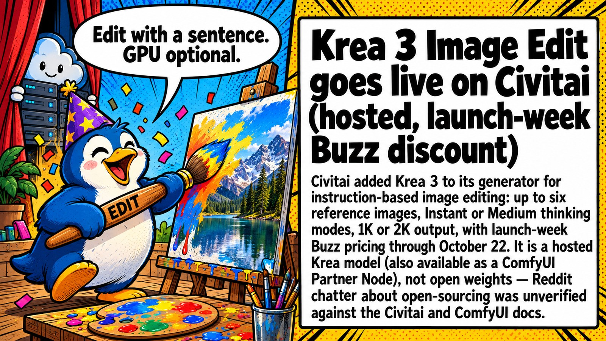

# 🤖 AI News Digest

Daily AI news from [4PDA's AI forum](https://4pda.to/forum/index.php?showforum=1240), curated with r/LocalLLaMA energy 🦾. Updated every day at 9:17 AM (UTC+7).

📅 **2026-10-16** · Mascot of the day: **Fry the Party Penguin 🐧🎉**

See also: [🗓️ Top of the week](weekly.md) · [📆 Top of the month](monthly.md)

📰 **TL;DR:** FLUX 3 Image Klein: 5.6B open weights for text-to-image, editing, and layout boxes · OpenCode makes DeepSeek V4.1 Flash free (limited time, ~200K context on Zen) · PS5LM Plus: Qwen 3.8 27B at ~20 tok/s on a jailbroken PS5's GPU 🔥🤯

1.  **[FLUX 3 Image Klein: 5.6B open weights for text-to-image, editing, and layout boxes](https://4pda.to/forum/index.php?showtopic=1112313&view=findpost&p=145531159)** 🎨 Finally, FLUX 3 you can actually download. 5.6B, open weights, layout boxes — localbros rejoice 🔥
2.  **[OpenCode makes DeepSeek V4.1 Flash free (limited time, ~200K context on Zen)](https://4pda.to/forum/index.php?showtopic=1077922&view=findpost&p=145520261)** 💸 DeepSeek V4.1 Flash went freemium on OpenCode. Grab it before the "limited time" ends 🏃‍♂️
3.  **[PS5LM Plus: Qwen 3.8 27B at ~20 tok/s on a jailbroken PS5's GPU](https://4pda.to/forum/index.php?showtopic=1077922&view=findpost&p=145518615)** 🎮 Your PS5 just became a 27B inference box. Jailbreak tax applies 💀
4.  **[Vecta v0.1.0: open-source Mac app turns PLAUD recorders into fully local AI](https://4pda.to/forum/index.php?showtopic=1077922&view=findpost&p=145518729)** 🎙️ PLAUD without the 300-minute tax. Mac does the AI, recorder just records ✨
5.  **[Krea 3 Image Edit goes live on Civitai (hosted, launch-week Buzz discount)](https://4pda.to/forum/index.php?showtopic=1112313&st=280)** 🖌️ Sentence-edit your pics on Civitai. Hosted only — weights stay behind the curtain 🚪
