# 📆 Top of the month

Last 30 days up to 2026-10-16 (by publication date). [⬅️ Today](README.md)

📰 **TL;DR:** OmGithub: discover and play open-source AI projects instantly · OpenAI launches GPT-6 Sol and GPT-6 Luna · FLUX 3 Image Klein: 5.6B open weights for text-to-image, editing, and layout boxes 🔥🤯

1. 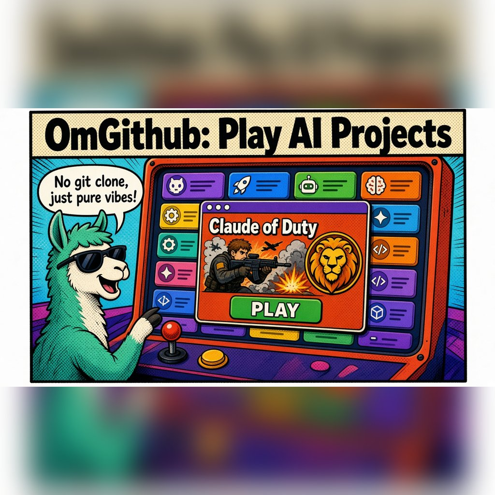 **[OmGithub: discover and play open-source AI projects instantly](https://omgithub.com)** 🚀 Every open-source AI project, playable in one click. No git clone, no npm install, just vibes. This is the way 🫡
2. 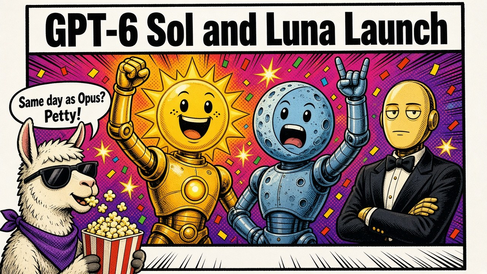 **[OpenAI launches GPT-6 Sol and GPT-6 Luna](https://4pda.to/forum/index.php?showtopic=1111449&st=1620)** ☀️🌙 Same day as Opus 5.5. Petty and we love it 🍿
3. 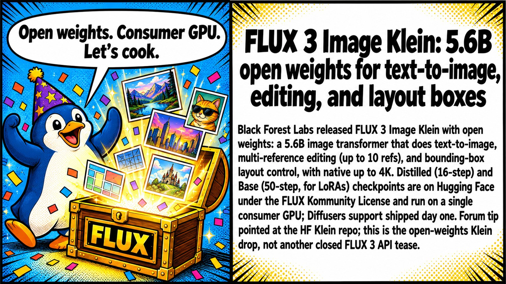 **[FLUX 3 Image Klein: 5.6B open weights for text-to-image, editing, and layout boxes](https://4pda.to/forum/index.php?showtopic=1112313&view=findpost&p=145531159)** 🎨 Finally, FLUX 3 you can actually download. 5.6B, open weights, layout boxes — localbros rejoice 🔥
4. 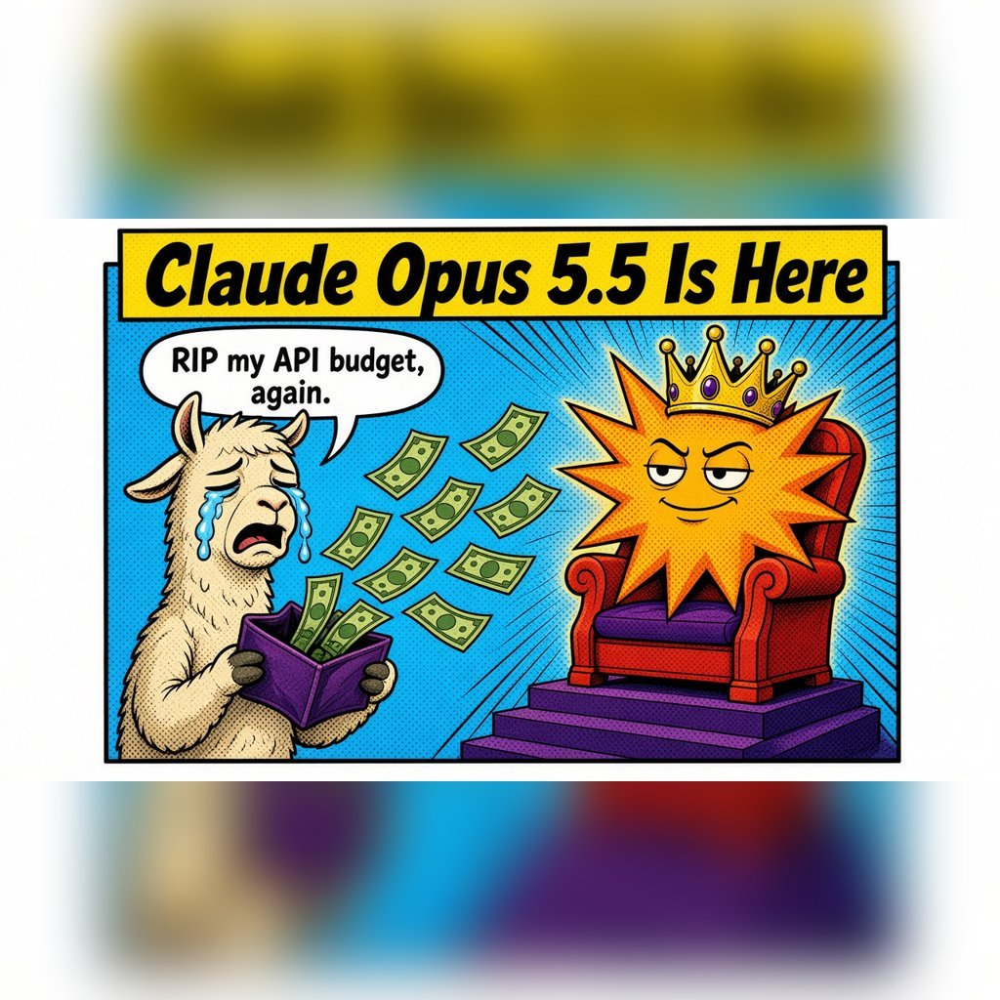 **[Anthropic releases Claude Opus 5.5](https://4pda.to/forum/index.php?showtopic=1111449&st=1620)** 🚀 New Opus dropped. RIP my API budget 💸
5. 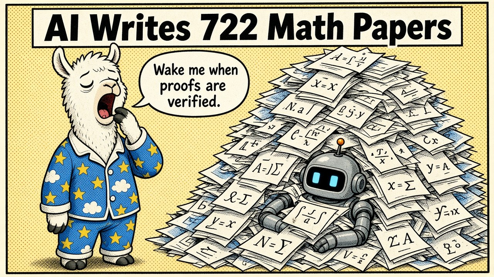 **[OpenAI publishes 722 AI-written math papers](https://4pda.to/forum/index.php?showtopic=1111449&st=1640)** 🧮 Cool, but it's an unreleased internal model 🔒. Wake me up when the proofs are verified 😴
6.  **[Genex: open-source AI game builder](https://4pda.to/forum/index.php?showtopic=1111449&st=1640)** 🎮 MIT-licensed and runs on local models. This is the way 🫡
7. 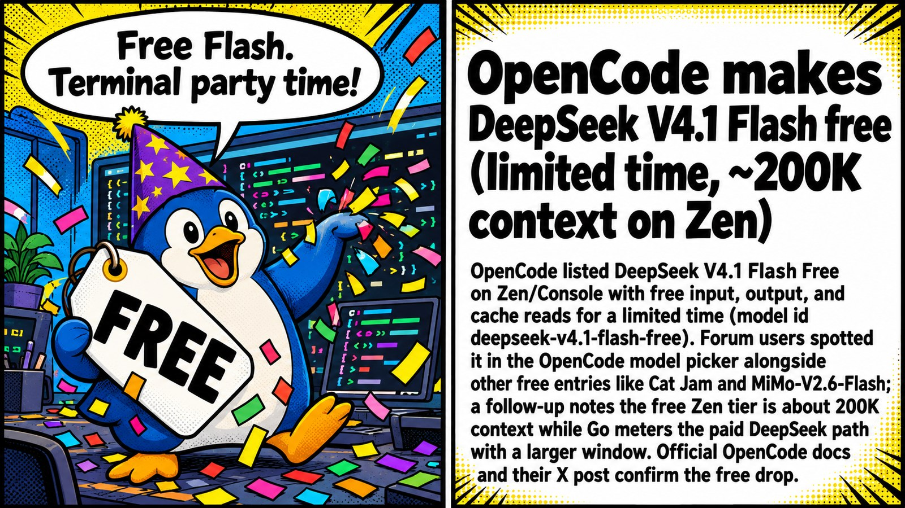 **[OpenCode makes DeepSeek V4.1 Flash free (limited time, ~200K context on Zen)](https://4pda.to/forum/index.php?showtopic=1077922&view=findpost&p=145520261)** 💸 DeepSeek V4.1 Flash went freemium on OpenCode. Grab it before the "limited time" ends 🏃‍♂️
8. 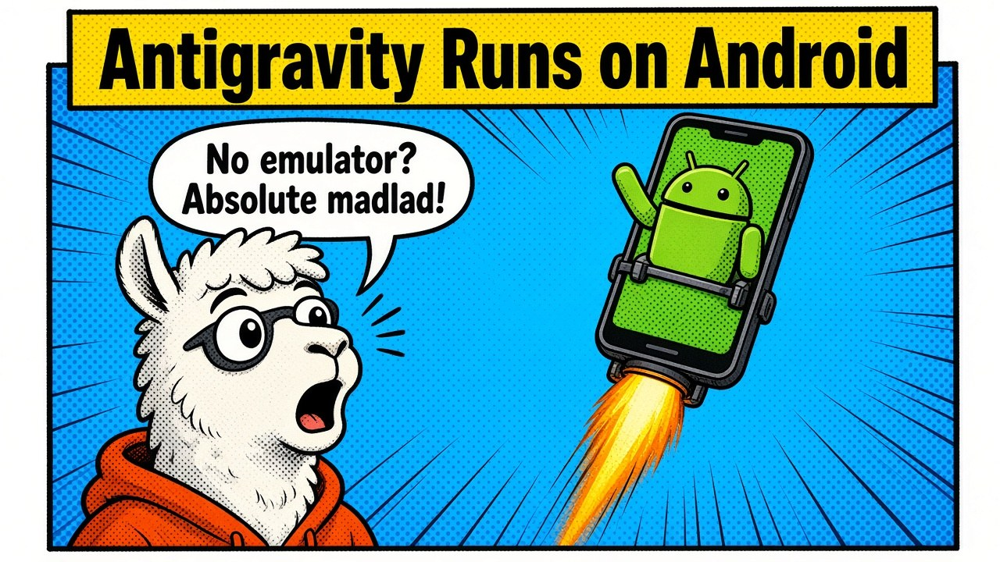 **[Google Antigravity agent runs natively on Android](https://4pda.to/forum/index.php?showtopic=1111449&st=1640)** 📱 No PRoot, no QEMU. Absolute madlad 🤠
9.  **[Gemini 4 Argon tops 13 of 19 Google tests](https://4pda.to/forum/index.php?showtopic=1111449&st=1620)** 🧪 13/19, Google flexing its own benchmarks 💪
10.  **[Cat Jam Free: stealth coding model on OpenCode Zen](https://4pda.to/forum/index.php?showtopic=1077922&view=findpost&p=145501804)** 🐱🎸 Free 262K coding stealth model just dropped on OpenCode Zen. Dev won't say who cooked it, rumor mill says Xiaomi MiMo — benchmarks or it didn't happen 👀
11.  **[Claude Sonnet 5.5 leads the Coding Agent Index; GPT-6.1 Sol is cheaper](https://4pda.to/forum/index.php?showtopic=1111449&st=1620)** 🏁 Sonnet wins the race, Sol wins the wallet 💰
12. 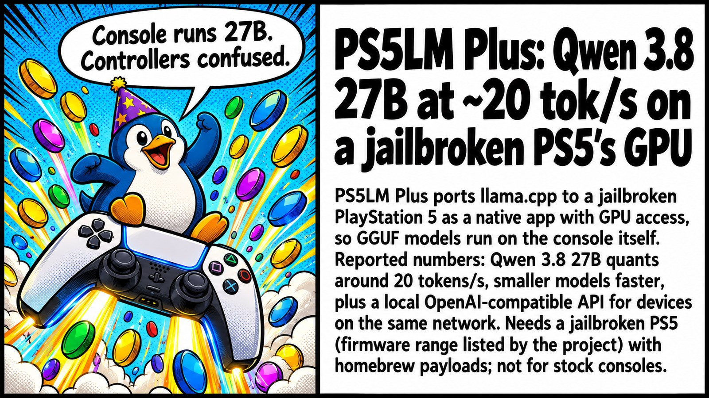 **[PS5LM Plus: Qwen 3.8 27B at ~20 tok/s on a jailbroken PS5's GPU](https://4pda.to/forum/index.php?showtopic=1077922&view=findpost&p=145518615)** 🎮 Your PS5 just became a 27B inference box. Jailbreak tax applies 💀
13. 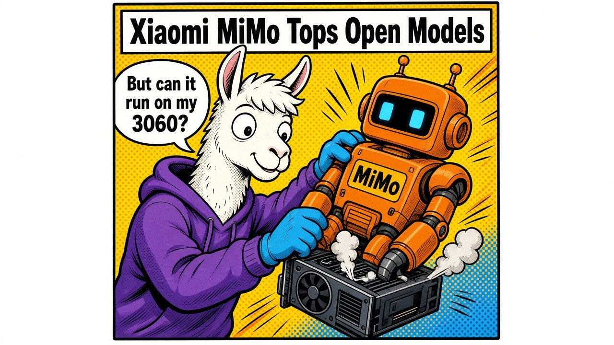 **[Xiaomi MiMo-V2.6-Pro tops open models](https://4pda.to/forum/index.php?showtopic=1111449&st=1620)** 🐉 #1 open model for pocket change 💸. Inb4 "but can it run on my 3060" 🥲
14.  **[Meta launches an AI game builder](https://4pda.to/forum/index.php?showtopic=1111449&st=1620)** 🎮 Zuck wants you making games in the metaverse again 🥽
15.  **[OpenAI DevDay: new console and 13 games made with Codex](https://4pda.to/forum/index.php?showtopic=1111449&st=1620)** 🕹️ 13 games from Codex. Indie devs: 'first time?' 😅
16. 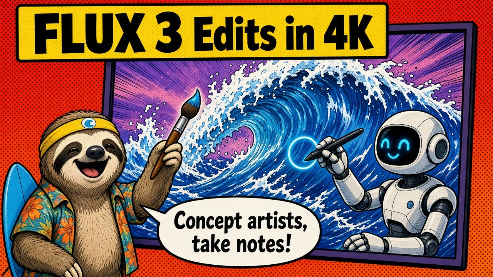 **[FLUX 3 Image with 4K editing](https://4pda.to/forum/index.php?showtopic=1111449&st=1620)** 🖼️ 4K edits. Concept artists, take notes 📝
17.  **[Phone Harness: Hermes Agent can now drive your iPhone and Android](https://4pda.to/forum/index.php?showtopic=1123739&view=findpost&p=145502480)** 📱🤖 Your agent now has thumbs. Taps, types, checks its own work on a real phone, no app APIs needed. What could possibly go wrong 💀
18.  **[Magnitude: inference 2x faster than llama.cpp](https://4pda.to/forum/index.php?showtopic=1111449&st=1620)** ⚡ 2x llama.cpp? Benchmarks or it didn't happen 📊
19.  **[Hermes Agent v0.22.0 'Threshold': no-key first chat, local llama.cpp, 600 vetted plugins](https://4pda.to/forum/index.php?showtopic=1123739&view=findpost&p=145512028)** 🧙‍♂️ Hermes 0.22 drops: zero-key onboarding, llama.cpp out of the box, 600 vetted plugins. Local gang eating good tonight 🍝
20. 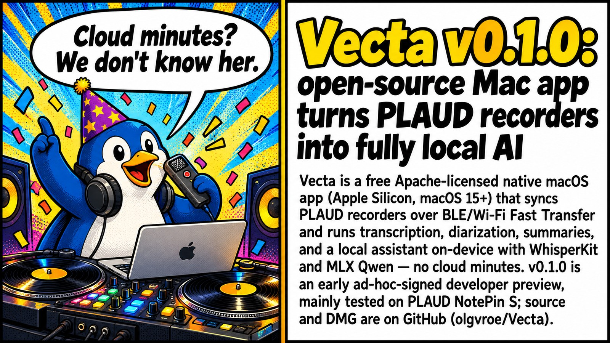 **[Vecta v0.1.0: open-source Mac app turns PLAUD recorders into fully local AI](https://4pda.to/forum/index.php?showtopic=1077922&view=findpost&p=145518729)** 🎙️ PLAUD without the 300-minute tax. Mac does the AI, recorder just records ✨
