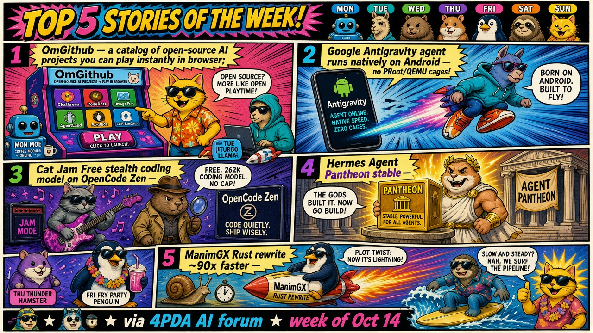

# 🗓️ Top of the week

Last 7 days up to 2026-10-15 (by publication date). [⬅️ Today](README.md)

📰 **TL;DR:** OmGithub: discover and play open-source AI projects instantly · Google Antigravity agent runs natively on Android · Cat Jam Free: stealth coding model on OpenCode Zen 🔥🤯

1. **[OmGithub: discover and play open-source AI projects instantly](https://omgithub.com)** 🚀 Every open-source AI project, playable in one click. No git clone, no npm install, just vibes. This is the way 🫡
2. **[Google Antigravity agent runs natively on Android](https://4pda.to/forum/index.php?showtopic=1111449&st=1640)** 📱 No PRoot, no QEMU. Absolute madlad 🤠
3. **[Cat Jam Free: stealth coding model on OpenCode Zen](https://4pda.to/forum/index.php?showtopic=1077922&view=findpost&p=145501804)** 🐱🎸 Free 262K coding stealth model just dropped on OpenCode Zen. Dev won't say who cooked it, rumor mill says Xiaomi MiMo — benchmarks or it didn't happen 👀
4. **[Phone Harness: Hermes Agent can now drive your iPhone and Android](https://4pda.to/forum/index.php?showtopic=1123739&view=findpost&p=145502480)** 📱🤖 Your agent now has thumbs. Taps, types, checks its own work on a real phone, no app APIs needed. What could possibly go wrong 💀
5. **[Hermes Agent v0.22.0 'Threshold': no-key first chat, local llama.cpp, 600 vetted plugins](https://4pda.to/forum/index.php?showtopic=1123739&view=findpost&p=145512028)** 🧙‍♂️ Hermes 0.22 drops: zero-key onboarding, llama.cpp out of the box, 600 vetted plugins. Local gang eating good tonight 🍝
6. **[REA (Reverse Engineering Anything): MCP server that reverse-engineers a binary and writes a free clone](https://4pda.to/forum/index.php?showtopic=1077922&view=findpost&p=145505557)** 🕵️ Give it a binary, get a FOSS clone back. Lawyers hate this one trick ⚖️🔥
7. **[Gemini 4 Argon rolls out to the Gemini app and pops up in Google Search, but eats quota fast](https://4pda.to/forum/index.php?showtopic=1077922&view=findpost&p=145513683)** 🧪 Argon is here. Smart, chatty, and two prompts nuke 20% of your Pro limit. Thinking tokens go brrr 💸
8. **[Fish Audio's 'ElevenLabs killer' TTS: ~40 GB weights, ~20 GB GGUF, great Russian](https://4pda.to/forum/index.php?showtopic=1110815&view=findpost&p=145513596)** 🎙️ 'ElevenLabs killer' that actually nails emotion tags. Bring a 3090 and some patience, local voice bros 🔊
9. **[ManimGX: Manim rewritten in Rust, ~90x faster](https://4pda.to/forum/index.php?showtopic=1111449&st=1640)** 🦀 Rewrite it in Rust, get 90x. The crab gods are pleased 🙏
10. **[Custom XiaoZhi ESP32-S3 firmware turns a ~390 RUB board into an Alexa](https://4pda.to/forum/index.php?showtopic=1117943&st=420)** 🔌 A ~390-ruble Alexa killer. Hardware hacking is so back 😎
